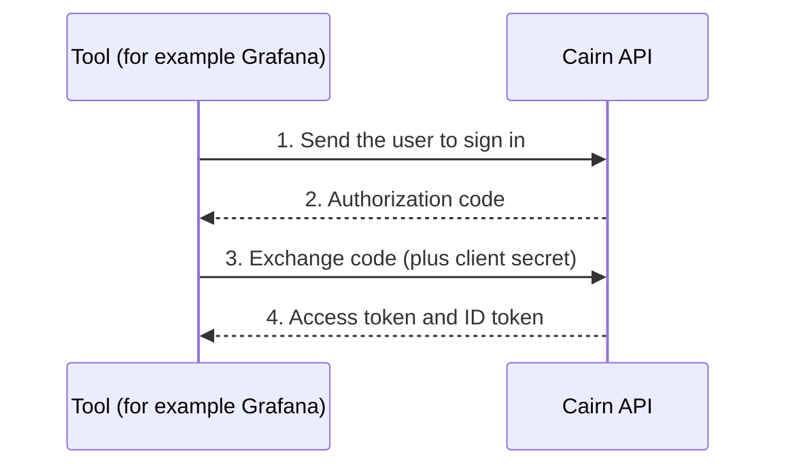

# Control who can sign in

This page helps you add people to Cairn and decide what each person can do. You manage people in **Users** in the sidebar, and your own account on your **Profile** page.

## Add a person

1. Open **Users** in the sidebar and choose **New user**.
2. Enter a name, email, username and a password of at least 8 characters.
3. Pick a role, for example **Developer**, and save.

The person can now sign in with their email (or username) and that password. They can change the password on their **Profile** page.

Only admins and DevOps users can create, edit or remove users.

## Pick a role

A role decides what a person can change. Every user has one of five roles.

| Role | Can do |
|---|---|
| Admin | Everything |
| DevOps | Manage infrastructure, users, secrets, databases and deployments |
| Tech lead | Manage projects, deployments, configuration and secrets. Cannot manage users. |
| Developer | See projects, trigger deployments, read logs and metrics |
| Viewer | Read-only: projects, deployments, logs and metrics |

The full list of what each role allows is in [Permissions](../api-reference/configuration/permissions.md).

To change someone's role, open **Users**, choose **Edit** on the person, pick the new role and save. You cannot give someone a role higher than your own. Only admins can make someone an admin or change an admin account.

## Your first admin account

The installer creates the first admin account. Its email and password are printed at the end of the install and saved on the server in `/etc/platform/.env` as `ADMIN_EMAIL` and `ADMIN_PASSWORD`.

## Other ways to sign in and stay safe

- **Two-factor sign-in.** Each person can add an authenticator app. Admins and DevOps users must. See [Two-factor sign-in](mfa.md).
- **GitHub or GitLab sign-in.** Once a Git provider is connected, people can sign in with it instead of a password. See [Connect GitHub or GitLab](git-providers.md).
- **One sign-in for the bundled tools.** Grafana, Argo CD, Portainer and the file-storage console use your Cairn account. You do not need separate passwords.
- **Secrets.** Keep passwords and API keys in Cairn, not in your repository. See [Secrets](secrets-management.md).
- **The server.** The installer turns on a firewall, SSH safeguards and automatic security updates. See [Host hardening](../host-hardening.md).

## How it works

### Sessions

Signing in returns a session token (a signed JSON Web Token, or JWT). The portal sends it with every request.

- A session lasts **24 hours**. There is no refresh token: after 24 hours you sign in again.
- A session that is only allowed to finish two-factor enrolment lasts **1 hour**.
- Session tokens are signed with `JWT_SECRET` using HS256.

Session token claims:

| Claim | Meaning |
|---|---|
| `id` | User ID |
| `email` | Email address |
| `name` | Display name |
| `role` | `admin`, `devops`, `tech_lead`, `developer` or `viewer` |
| `amr` | How the user signed in: `pwd` (password) or `fed` (GitHub/GitLab), plus `otp` and `mfa` after a second factor |
| `auth_time` | When the user last authenticated (seconds). A two-factor step-up refreshes it. |
| `mfa_enroll` | Present only on sessions limited to two-factor enrolment |
| `iat`, `exp` | Issued at and expiry |

Source: `platform/api/src/lib/session-token.ts`.

Users with two-factor sign-in turned on get a short challenge first, then a session after the code. See [Two-factor sign-in](mfa.md).

### Roles and permissions

Each role is a set of permission strings defined in `platform/api/src/config/permissions.ts`. There are 63 permissions in total. Admin has all of them. The exact list per role is in [Permissions](../api-reference/configuration/permissions.md).

**Custom roles.** You can also create named roles with any set of permissions, through the API (the portal has no screen for this). A user keeps their built-in role and can also have one custom role. Their permissions are the two sets combined.

System roles (`isSystem: true`) cannot be changed or deleted. Deleting a custom role removes it from every user who had it.

**Permission cache.** The API caches each user's permissions for 60 seconds. Changing a user's role, or editing or deleting a custom role, clears the cache for the affected users. When several API replicas run, the clear is sent to every replica through Redis. While that channel is down, the API skips the cache and reads permissions from the database.

### OIDC/SSO

The API is also a small OpenID Connect (OIDC) provider. OIDC is the standard that lets other tools accept your Cairn sign-in. The installer registers the bundled tools as clients (`platformctl/internal/config/oidc.go`):

| Client | Redirect address |
|---|---|
| `grafana` | `https://<domain>/grafana/login/generic_oauth` |
| `argocd` | `https://<domain>/argocd/auth/callback` |
| `portainer` | `https://portainer.<domain>/` |
| `oauth2-proxy` | `https://<domain>/oauth2/callback` |
| `minio` | `https://minio.<domain>/oauth_callback` |



- Only the authorization code flow is supported. PKCE with S256 is supported.
- An authorization code is single use and expires after **2 minutes**.
- Access tokens and ID tokens are signed with RS256 and last **1 hour**.
- The ID token includes `sub`, `email`, `name`, `groups` and `roles`. `groups` and `roles` both hold the user's role, for example `["devops"]`. `amr` and `auth_time` are copied from the portal session, so a tool can require two-factor sign-in.
- The issuer is `https://<domain>/api/oauth`.

Grafana maps groups to its own roles with this rule (`platformctl/internal/manifests/data/grafana-values.yaml`):

```text
contains(groups[*], 'Admin') && 'Admin' || contains(groups[*], 'DevOps') && 'Admin' || contains(groups[*], 'Tech Lead') && 'Editor' || 'Viewer'
```

oauth2-proxy (installed from `platformctl/internal/manifests/data/oauth2-proxy-values.yaml`) is an OIDC client too. It uses the public authorize address for the browser and in-cluster addresses for token, keys and user info, so sign-in works before the public certificate is valid. Its cookie lasts 24 hours and refreshes every 5 minutes.

## For developers / API

### Sign in

`POST /api/auth/login` with `{ "email": "...", "password": "..." }`. You can send `username` instead of `email`. The answer is either a session token or, for users with two-factor sign-in, `mfa_required` and a challenge token to finish at `POST /api/auth/mfa/challenge`.

### Users and roles

| Method | Path | Needs |
|---|---|---|
| `GET` | `/api/users` | admin, devops or tech lead |
| `POST` | `/api/users` | admin or devops |
| `PUT` / `DELETE` | `/api/users/:id` | admin or devops |
| `PATCH` | `/api/users/:id/role` | `users.assign-role` |
| `GET` | `/api/users/:id/permissions` | signed in |
| `GET` | `/api/roles`, `/api/roles/:id` | `users.list` |
| `POST` | `/api/roles` | `users.create` |
| `PUT` | `/api/roles/:id` | `users.update` |
| `DELETE` | `/api/roles/:id` | `users.delete` |
| `GET` | `/api/permissions` | `users.list` |

Create a custom role:

```http
POST /api/roles
Authorization: Bearer <token>
Content-Type: application/json

{
  "name": "database-admin",
  "description": "Can manage all database operations",
  "permissions": ["databases.provision", "databases.backup", "databases.restore"]
}
```

Give it to a user (`role` sets the built-in role, `roleId` links the custom role):

```http
PATCH /api/users/:id/role
Authorization: Bearer <token>
Content-Type: application/json

{ "role": "developer", "roleId": "a1b2c3d4-..." }
```

### OIDC endpoints

| Method | Path | Purpose |
|---|---|---|
| `GET` | `/api/oauth/.well-known/openid-configuration` | Discovery document |
| `GET` | `/api/oauth/jwks` | Public signing keys |
| `GET` | `/api/oauth/authorize` | Start sign-in (`client_id`, `redirect_uri`, `response_type=code`) |
| `POST` | `/api/oauth/token` | Exchange the code (`grant_type=authorization_code`) |
| `GET` | `/api/oauth/userinfo` | User info for an access token |
| `POST` | `/api/oauth/signing-key/rotate` | Rotate the signing key (admin) |

After a key rotation the previous key stays in the key list, so tokens it signed keep working until they expire.
